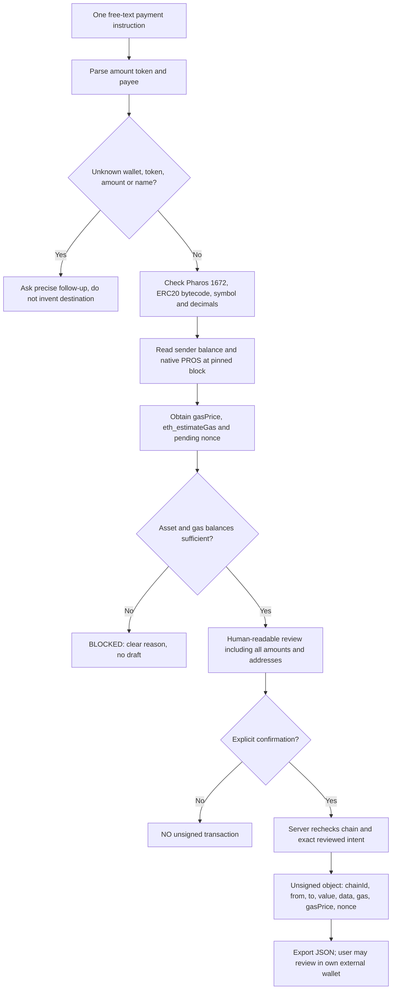

# Natural-Language Payment Agent — Pharos Agent Arena

**Task:** Medium / Payments / 100 points · [Live Cloudflare Worker](https://natural-language-payment-agent.trantanlong2411.workers.dev/) · [Reviewer proof page](https://natural-language-payment-agent.trantanlong2411.workers.dev/proof)

A **read-only, unsigned-only natural-language payment workflow**. It turns an instruction like `send 100 USDC to alice.eth` into an explicit question about the unresolved recipient, validates an actual 0x address and a real public Pharos sender's token/native-gas balances, displays a fully sourced human-readable preview, then—**only after confirmation**—produces a JSON transaction object for external wallet review. The application never signs, connects a wallet, holds private keys or broadcasts.

## Strict human-in-the-loop action pattern



There is **no action after export** on this app. It provides no wallet integration, signing or transfer endpoint.

## Four task requirements

| Challenge requirement | Implementation and how to verify |
| --- | --- |
| Parse token, amount and recipient; ask follow-up for ambiguity | Strict one-payment parser in `src/parser.mjs`. Accepts `send`, `pay`, `transfer`, precise decimals and exact single recipient. Unresolved `alice.eth` and sender require explicit 0x addresses; unsupported tokens and malformed/multiple instructions are refused. |
| Validate recipient, token contract and sufficient balance | On-chain Pharos Mainnet chain ID 1672, token contract code, real decimals/symbol, `balanceOf(sender)`, native PROS `eth_getBalance`, `eth_estimateGas`, gas price. Insufficient token or gas balance blocks draft. |
| Human-readable summary *before* unsigned transaction | `POST /api/review` returns blockchain block, verified balance, recipient, amount, fee reserve and checklist. Calldata is not exposed in the public review response. Browser requires an explicit checkbox after the summary. |
| Never sign/send on its own | `POST /api/prepare` only when the same fingerprinted intent is explicitly confirmed; it rechecks balances and returns **unsigned** `chainId/from/to/value/data/gas/gasPrice/nonce`. RPC allowlist excludes `eth_sendRawTransaction`, `eth_sendTransaction`, personal-sign and wallet signing. |

## Supported assets and known mainnet contracts

| Token | Contract | Precision |
| --- | --- | --- |
| USDC (official Circle) | `0xC879C018dB60520F4355C26eD1a6D572cdAC1815` | 6 |
| Native PROS | native currency (no ERC20 address) | 18 |
| WPROS | `0x52c48d4213107b20bc583832b0d951fb9ca8f0b0` | 18 |
| WETH | `0x1f4b7011Ee3d53969bb67F59428a9ec0477856E9` | 18 |

All ERC20 contracts are rechecked via actual bytecode and symbol/decimals RPC calls at one pinned Pharos block. Unsupported or malicious token addresses cannot be supplied ad hoc.

USDC mainnet address: [official Circle announcement](https://www.circle.com/blog/now-available-usdc-cctp-on-pharos). Network: [Pharos documentation](https://docs.pharos.xyz/getting-started/network). Transfer calldata uses `transfer(address,uint256)` per [ERC-20](https://eips.ethereum.org/EIPS/eip-20). Chain RPC `https://rpc.pharos.xyz`, chain ID 1672.

## Independent on-chain audit and sample

A real GitHub Actions Pharos RPC audit (chain 1672) verified Circle USDC at block **22023746**, and discovered a public third-party externally-owned address with **1,940.189315 USDC** and **18.152564157241695028 PROS** at the time of the read. See [the permanent observation](./proof/public-funding-observation.json) and the [CI workflow](https://github.com/trantanlong2411-droid/Natural-Language-Payment-Agent/actions/workflows/verify.yml).

The interactive dashboard now has **Load verified public example**, which fills that public sender and a sample 0x recipient, then asks the Worker to validate them afresh. The project does not control this EOA and cannot sign or send any payment from it. The observed balances are historical and can change at any time.

## Cloudflare production deployment status

**Deployment requires verification before submission.** GitHub test/build passed, but the first live Worker integration received a **Cloudflare 404 HTML page** at the expected `/api/health` URL. The repository's [DEPLOYMENT.md](./DEPLOYMENT.md) documents Cloudflare **Settings → Builds** and the required repository/Worker name match. A successful unit or direct-RPC test does not imply the Cloudflare Worker is live. After Cloudflare deploy, rerun the CI live-worker test and ensure the `unsignedDraftReady` result is actually true before claiming a fully verified live transaction draft.

## Reviewer walkthrough

1. Go to [the Worker](https://natural-language-payment-agent.trantanlong2411.workers.dev/). With the prefilled `send 100 USDC to alice.eth`, click **Parse my instruction**. Check the recipient and sender clarification prompt.
2. Enter a **verified EVM 0x recipient** and a **public mainnet sender**. Click **Validate on Pharos Mainnet**.
3. Verify the returned chain, token contract, actual sender token balance, native PROS balance and gas estimation. If the sender lacks funds, this is a **correct refused result**, not a simulated success.
4. For a sender with >=100 real USDC and native PROS gas, review all details and check the consent box. Click **Generate unsigned transaction**; inspect its ERC20 `0xa9059cbb` selector and decode recipient + 100,000,000 base-unit USDC. Export JSON.
5. See [CI workflow](https://github.com/trantanlong2411-droid/Natural-Language-Payment-Agent/actions/workflows/verify.yml), which exercises the deployed Worker against real Pharos RPC, plus offline tests of every requirement and security boundary.

## Endpoints

- `GET /`: interactive user interface.
- `GET /proof`: reviewer walkthrough and permanent sources.
- `GET /api/health`: deployment version and read-only characteristics (**not a live chain health check**).
- `POST /api/parse`: text + sender/resolvedRecipient. Asks follow-up on missing inputs, no on-chain reads.
- `POST /api/review`: the same input, live blockchain validation, human-readable preview and non-secret fingerprint.
- `POST /api/prepare`: the same input, original `reviewId` and `confirmed:true`; repeats blockchain checks and emits unsigned fields only if still valid.

Review ID is an *intent-matching fingerprint*, not authentication, a signature or spending approval. A JSON object created for a public address cannot give you permission to spend that address's assets.

## Security and honest limitations

- **No automatic ENS/name resolution:** `alice.eth` is a label, not a verified Pharos address; user must supply a confirmed 0x address. The app intentionally asks follow-ups.
- **No hosted LLM or official Harbor SDK integration:** this is a deterministic generalized action-pattern implementation of the assigned payment task.
- **No false balance or readiness:** a public sample wallet with zero USDC is correctly rejected. CI might discover a third-party funded sender for a **non-broadcast** unsigned example, but the project does not control that address and cannot actually send from it.
- **Gas and nonce are changeable:** pinned balance and pending nonce may become stale. `eth_estimateGas` may fail or underestimate execution needs; always revalidate in your wallet.
- **No signing authority:** no wallet connection, signatures, approvals, transactions or on-chain receipts are generated by the app.
- **Server-side intent is validated twice**, but client `confirmed:true` is a user-interface consent signal, not an identity proof.

## Local tests and deployment

```bash
npm install
npm test
npm run build
npx wrangler deploy
```

CI: [Unit/build + direct Mainnet engine verification](https://github.com/trantanlong2411-droid/Natural-Language-Payment-Agent/actions/workflows/verify.yml) · [Separate post-deployment Worker validation](https://github.com/trantanlong2411-droid/Natural-Language-Payment-Agent/actions/workflows/verify-deployed.yml)

Raw verification script: `scripts/smoke-deployed.mjs`; source: `src/parser.mjs`, `src/engine.mjs`, `src/worker.mjs`.
